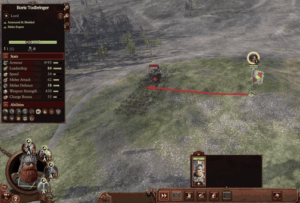
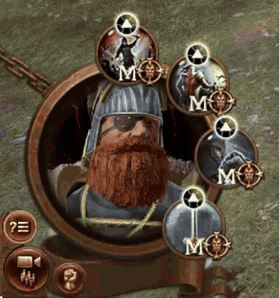

# Smart Ability Autocast

A Total War: WARHAMMER III battle mod. Your Lords, Heroes and units use their own abilities at the
right moment, while you command the battle. No setup needed: install it and fight.

**[Get it on the Steam Workshop](https://steamcommunity.com/sharedfiles/filedetails/?id=3844023013)**



## How it works

Every ability on the ability wheel gets a small letter: **M** for manual, **A** for automatic.



- Click the letter to switch that ability for the selected unit. Each unit has its own switch.
- Hover the letter to read when the ability fires.
- A button next to the wheel switches every ability of the selected units to automatic, or back to manual.
- Your choices are remembered per unit type and ability. The next battle starts with them.

## Each ability has its own trigger

The trigger follows what the ability does. A few examples:

- Charge bonuses fire when the unit charges.
- Melee buffs fire in melee, and not while the unit wavers.
- Heals fire on the most hurt ally in range.
- Hexes and debuffs fire on an enemy that is fighting.
- Roots and slows fire on a fast enemy that is running at your army.
- Breaths, bombs and blasts are aimed where they hit the most enemies, and they hold when your own units stand in the way.
- Finishers wait for an enemy below their execute line.

1,035 abilities of characters, units, mounts and items are covered, on 141 kinds of trigger.

Simple, safe abilities start on **A**. Abilities with a risk for your own army (rampage, self damage)
start on **M**.

Not automated, on purpose: spells and everything else on the right-hand bar, army abilities, stances.

## Compatibility

- Single-player campaign battles and custom battles. In a multiplayer battle the mod does nothing.
- No save game data is changed. You can add or remove the mod at any time.
- Units from other mods work when their abilities are the game's own.
- Optional: with the Mod Configuration Tool installed, its settings page has a button that forgets the remembered M/A choices.

## For developers

The mod is one Lua battle script. The Workshop build is generated from the development script, which
also carries the logging and the test switches.

| Path | What it is |
|---|---|
| `mod_source/script/battle/mod/zz_test_deadly_onslaught.lua` | the development script (with logging) |
| `mod_source/release/` | the generated Workshop build (`tools/build_release.py`) |
| `mod_source/ui/` | the letter template and images |
| `mod_source/workshop/` | the Workshop description, preview image and GIFs |
| `mod_source/releases/` | one folder per round: test harness, build script, run log |
| `tools/` | builders, generators, verifiers and the test runner (Python) |
| `docs/` | the ability tracker, the master database and workbooks, one document per round |

The tests are Lua harnesses run under [lupa](https://github.com/scoder/lupa). The full suite is about
8,500 checks:

```
uv run --with lupa python tools/run_harness.py mod_source/releases/<round>/harness<N>.lua
```

Packing uses [RPFM](https://github.com/Frodo45127/rpfm), which is not included here. Each round's
`build_and_install<N>.py` drives it, checks every gate, and installs the pack.

Not included: battle logs, built packs, and the game data extracted from the installed game (it
belongs to Creative Assembly). The tools regenerate the game data locally. Every number the mod uses
about an ability (ranges, blast sizes, recharge times) is generated from that data, never typed by hand.

## Feedback

Tell me which ability fired at the wrong moment, with the unit and the situation. Every trigger can be
tuned. Comments on the Workshop page or an issue here both work.

Ko-fi: https://ko-fi.com/vladyskaizen
